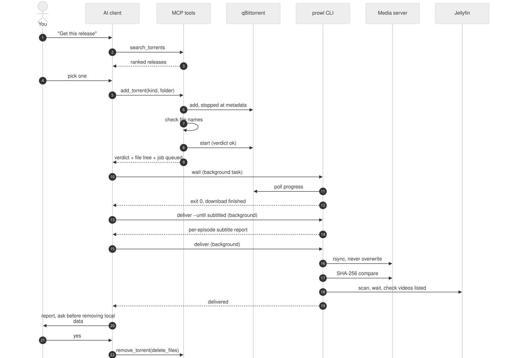
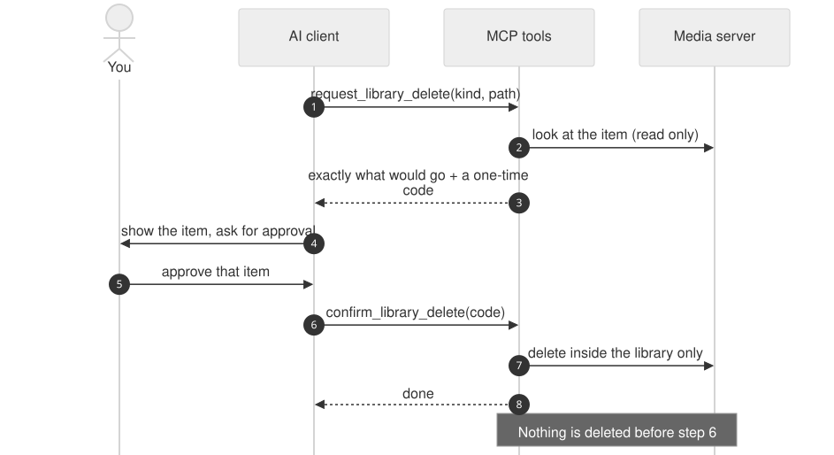

# prowl-mcp

A local [Model Context Protocol](https://modelcontextprotocol.io) server that lets an AI assistant run a personal media workflow end to end: **find** a release, **check** it, **download** it, **embed subtitles**, **deliver** it to a home media server, **verify** the copy, and **refresh** the media library, with the user in control of every deletion.

It ties together three self-hosted tools (Prowlarr, qBittorrent, Jellyfin) behind 19 MCP tools, a small command-line interface, and background timers. Everything runs locally; nothing is exposed to the internet.

> **Use it only for media you own, have licensed, or that is legally free to distribute** (open-licensed, public domain, your own backups). The software is a workflow tool. It does not decide what you are allowed to download; that is your responsibility.



## Contents

1. [What it does](#1-what-it-does)
2. [How the system works](#2-how-the-system-works)
3. [The delivery pipeline](#3-the-delivery-pipeline)
4. [Choosing the right path: tools, CLI, worker, terminal](#4-choosing-the-right-path)
5. [The 19 MCP tools](#5-the-19-mcp-tools)
6. [The `prowl` command line](#6-the-prowl-command-line)
7. [Safety and approvals](#7-safety-and-approvals)
8. [What keeps running when you close the AI session](#8-what-keeps-running-when-you-close-the-ai-session)
9. [Setup](#9-setup)
10. [Configuration reference](#10-configuration-reference)
11. [Project layout](#11-project-layout)
12. [Working with an AI assistant](#12-working-with-an-ai-assistant)
13. [Troubleshooting](#13-troubleshooting)
14. [Limits and status](#14-limits-and-status)
15. [License](#15-license)

---

## 1. What it does

| Step | What happens | Handled by |
|---|---|---|
| Find | Searches your indexers through Prowlarr with up to three query variants, merges and ranks the results by seeders | `search_torrents` |
| Check | Adds the torrent **stopped**, reads its file list, and classifies it by file names before a byte is downloaded | `add_torrent`, `check_torrent` |
| Download | qBittorrent downloads it in a Docker container | qBittorrent |
| Subtitles | Embeds a matching English `.srt` into each video, per episode for season packs, then verifies the result | `process_subtitles`, `prowl deliver` |
| Deliver | Copies the final file to the media server with rsync over SSH, names episodes the way Jellyfin expects, never overwrites | `transfer_torrent`, `prowl deliver` |
| Verify | Compares sizes and SHA-256 checksums of every file | built into delivery |
| Publish | Asks Jellyfin to rescan, waits for the scan, and checks that each video is listed | built into delivery |
| Clean up | Removes the torrent and local files **only after the user says so** | `remove_torrent` |

Design goals, in order: **correct** (every copy is verified), **safe** (nothing is deleted without approval, nothing leaves the local network), **resumable** (any step can crash and be run again), and **hands-off when you want it** (delivery continues with no AI session open).

## 2. How the system works

### 2.1 Components

| Component | Role | Where it runs |
|---|---|---|
| AI client | Talks to you, calls MCP tools, starts background tasks, decides what to do next | Your laptop (for example Claude Code) |
| prowl-mcp server | Exposes the 19 tools over stdio; started as a child process of the AI session | Your laptop |
| `prowl` CLI | The same pipeline logic as a command line, for long jobs | Your laptop |
| systemd timers | Run the delivery worker and the desktop notifier every 5 minutes, with no AI session | Your laptop |
| Prowlarr | Aggregates your configured indexers into one search API | Docker, laptop |
| qBittorrent | Downloads and keeps the torrent list; restarts automatically | Docker, laptop |
| Media server | Holds the TV and Movies folders and runs Jellyfin | Another machine, reached over SSH |
| Jellyfin | Scans the library and streams to your devices | Media server |

### 2.2 Code layers

The code has three layers so each part stays small and testable. Entry points never talk to outside systems directly; services hold the logic; clients wrap one outside system each.



- `tools/` defines MCP tools and does nothing but call a service.
- `cli.py` defines the command line and calls `services/pipeline.py`.
- `services/` holds the rules: safety checks, subtitle embedding, transfer planning, job stages.
- `clients/` wraps the Prowlarr, qBittorrent and Jellyfin HTTP APIs.
- `config.py` reads every setting from the environment (`.env`) once.

### 2.3 Where state lives

There is no database. State is plain files plus what the outside systems already keep.



| State | Location | Notes |
|---|---|---|
| Settings and secrets | `.env` in the repo | Git-ignored; `.env.example` lists every key |
| Job per torrent | `~/.cache/prowl-mcp/jobs/<hash>.json` | Stage, destination, attempts, last error, last result; written atomically |
| Pipeline lock | `~/.cache/prowl-mcp/runner.lock` | Frees itself if the holder crashes |
| Popup state | `~/.cache/prowl-mcp/notified.json` | So each finished download pops up once |
| Torrent list and progress | qBittorrent (Docker volume) | |
| Final media | Media server library folders | |

## 3. The delivery pipeline

### 3.1 The whole story as a sequence



1. You ask for something; the AI searches and shows you ranked options.
2. You pick one. `add_torrent` adds it stopped, reads the file list, classifies it, and shows you **the full file tree in chat** so you can see exactly what will be downloaded. The destination (`kind` and `folder`) is recorded as a **job**.
3. The AI runs `prowl wait` as a background task. It polls qBittorrent (plain code, no AI cost) and exits when the download finishes, stalls, is stopped, or errors. The AI is woken by the exit and reacts.
4. The AI runs `prowl deliver --until subtitled`, reads the per-episode subtitle report, then `prowl deliver` for the transfer.
5. The AI reports the verified result and **asks** before removing the torrent and its local files.

### 3.2 Job states

Each torrent that should be delivered has a job file. Stages only move forward, and every stage is safe to run twice, so a retry after any crash continues where it stopped.


| Stage | Meaning |
|---|---|
| `downloading` | Queued; waiting for the download, or subtitles not done yet |
| `subtitled` | Subtitles done; copy not done yet |
| `delivered` | Copied, checksums match, Jellyfin checked; waiting for your removal decision |
| `failed` | Three failed attempts in a row; needs a look. `deliver` or `queue_delivery` retries it |

### 3.3 The safety check on add

The check reads **file names only**. It cannot prove a file is safe and it does not open archives, so treat it as a filter for obvious problems, not a guarantee.



| Verdict | Trigger | Result |
|---|---|---|
| `ok` | Nothing flagged | Download starts |
| `suspicious` | Archives, link files, hidden files or folders | Held stopped until the user resumes it |
| `unsafe` | Executable file types, or an executable disguised with a media extension (for example `video.mkv.exe`) | Torrent and files removed immediately |
| `unknown` | No file list arrived in time | Held stopped |

### 3.4 Subtitles, per video

For a season pack each episode is handled on its own, matched by episode code. An episode that already has an English track is left alone, and one failure does not stop the others (the run reports every failure at the end and a retry skips finished episodes).



The embed step writes to a temporary file, probes it, and only then replaces the original, so a failed run never damages the downloaded file.

### 3.5 The transfer, in detail



- **Final file only.** The file pushed to the server is the final, subtitle-processed one, never the raw download.
- **Naming.** With a TV `folder` such as `Example Show (2020)/Season 01`, videos are renamed `Example Show (2020) - S01E01.mkv`, the layout Jellyfin matches reliably. A pack leaves no release-named folder behind.
- **Never overwrites.** A file already on the server with the same name and size counts as present (and its checksum is still verified); a same-name file with another size is an error, not a replacement.
- **Resumes.** An interrupted copy continues from a partial file kept in a hidden folder on the server, so a half-copied file is never mistaken for a finished one.
- **Stays inside the library.** Folder names with `..`, absolute paths or newlines are rejected.
- **Local files are kept** until you approve removal.

## 4. Choosing the right path

An MCP tool call blocks the chat while it runs and ends with the AI session. A background command does not: the AI client starts it, goes on with other work, and is woken when it exits. So the rule is simple:

> **Short and interactive goes through the MCP tools. Long and unattended goes through the CLI as a background task, or the worker timer.**



| Task | Use |
|---|---|
| Search, add, status, pause, resume, list the library | MCP tools |
| Wait for a long download | `prowl wait <hash>` as a background task |
| Subtitles, transfer, checksums, Jellyfin check | `prowl deliver <hash>` as a background task |
| Deliver while you are away or no AI session is open | The `prowl-worker` systemd timer (needs a queued job) |
| Retry a failed job | `queue_delivery`, `prowl deliver`, or `finish_torrent` |
| A tool errors or does not cover the case | Plain `ssh`, `scp`, `ffprobe`, `docker`, `journalctl` |
| Delete anything | Ask the user first |

## 5. The 19 MCP tools

| Area | Tool | What it does |
|---|---|---|
| Find | `search_torrents` | Searches with 1 to 3 query variants, merges, ranks by seeders, remembers the results for this session |
| Add | `add_torrent` | Adds a result from this session by info-hash, runs the safety check, starts or holds or removes it. With `kind` and `folder` it also queues delivery |
| Add | `check_torrent` | Re-runs the safety check; returns the verdict and the full folder and file tree with sizes |
| Jobs | `queue_delivery` | Sets or changes where a torrent goes; clears a failure |
| Jobs | `list_jobs` | Lists every job with stage, attempts, last error and last result |
| Control | `find_torrents` | Lists torrents whose name contains a text, or matching a hash |
| Control | `get_torrent_status` | State, progress, speed, ETA, seeds |
| Control | `pause_torrent`, `resume_torrent` | Stops or starts one torrent; resume reports whether data is flowing |
| Control | `remove_torrent` | Removes a torrent; `delete_files=true` also deletes local data (ask first); also drops its job |
| Control | `check_disk_space` | Free space on the download folder |
| Process | `process_subtitles` | Embeds the matching English `.srt` into each video, per episode |
| Deliver | `finish_torrent` | Queues and runs the whole delivery in one blocking call; also retries a failed job |
| Deliver | `transfer_torrent` | Copy, checksums, Jellyfin check, without the subtitle step |
| Deliver | `list_library`, `list_server_folder` | Read-only listing of the TV or Movies library, or one folder in it |
| Deliver | `refresh_library` | Asks Jellyfin to rescan and waits for the scan to end |
| Delete | `request_library_delete`, `confirm_library_delete` | Two-step server delete; see [section 7](#7-safety-and-approvals) |

Only hashes returned by `search_torrents` in the current session can be added, so the assistant cannot be talked into adding an arbitrary magnet link.

## 6. The `prowl` command line

Run from the repository folder. Each command is built to run as a background task, and its exit code tells the AI client what happened.

```bash
uv run python -m prowl_mcp.cli <command>
```

| Command | Purpose |
|---|---|
| `queue <hash> --kind tv --folder "Example Show (2020)/Season 01"` | Record where a torrent goes (`--no-rename` keeps original names) |
| `wait <hash>` | Block until the download finishes, stalls, is stopped, or errors |
| `deliver <hash> [--until subtitled]` | Run the remaining stages of the job; `--until subtitled` stops before the transfer so you can check the subtitle report |
| `jobs` | List every job and its stage |
| `worker` | One pass over all open jobs (what the timer runs) |

Exit codes for `wait`: `0` finished, `2` no progress for `WAIT_STALL_MINUTES`, `3` stopped, `4` qBittorrent error state. For `deliver` and `worker`: `0` fine, `1` a job failed (the error is printed).

## 7. Safety and approvals



- **Deletion needs approval, always.** Deleting on the media server is a two-step flow: `request_library_delete` shows exactly what would go and returns a one-time code; only after the user approves that item does `confirm_library_delete` run. Deleting local downloads or removing a torrent with its data also waits for the user's yes.
- **The pipeline never deletes.** Delivery ends by asking.
- **Nothing is overwritten.** Not on the server, and not a downloaded file (the subtitle step swaps files only after a verified temporary copy).
- **Everything is checked.** Sizes and SHA-256 for every file.
- **Local only.** The MCP server speaks stdio to the client that started it, with no network listener. The Prowlarr and qBittorrent web interfaces bind to the loopback interface only.
- **Secrets stay in `.env`.** Never printed, never committed.
- **Single writer.** A file lock makes sure only one process runs delivery stages at a time, so a torrent is never processed twice.
- **A finished-task notice is not an answer.** Background task results wake the assistant, but only a message from the user counts as approval.

## 8. What keeps running when you close the AI session


| Keeps going | Stops |
|---|---|
| qBittorrent downloads (Docker, `restart: unless-stopped`) | The MCP server and any tool call in progress |
| Job files on disk | Background tasks started by the session |
| The worker timer delivers finished jobs | |
| The notifier timer shows popups | |

Next session, `list_jobs` reports what happened while you were away. The laptop must be awake: if it sleeps, downloads and the worker pause and resume when it wakes.

## 9. Setup

Requirements: Linux, Docker with Compose, [uv](https://docs.astral.sh/uv/), Python 3.11+, `ffmpeg` and `ffprobe`, `rsync` and `ssh`, `notify-send` (optional, for popups), and a media server running Jellyfin that you can reach by SSH with a key.

1. **Configure.** Copy `.env.example` to `.env` and fill in every key (see [section 10](#10-configuration-reference)). Never commit `.env`.
2. **Start Prowlarr and qBittorrent.**
   ```bash
   scripts/prowl-up.sh        # stop with scripts/prowl-down.sh
   ```
3. **Set up Prowlarr and qBittorrent once** in their web interfaces (indexers, API key, web UI credentials), and put the values in `.env`.
4. **Register the MCP server** with your client. For Claude Code:
   ```bash
   claude mcp add prowl-mcp -- uv run --directory "$PWD" python -m prowl_mcp.server
   ```
   Restart the session after any code change; a session keeps the code it started with.
5. **Install the background timers** (optional but recommended). Edit the `WorkingDirectory` and `ExecStart` paths in `scripts/systemd/*.service` to match your machine, then:
   ```bash
   mkdir -p ~/.config/systemd/user
   cp scripts/systemd/prowl-worker.* scripts/systemd/prowl-notify.* ~/.config/systemd/user/
   systemctl --user daemon-reload
   systemctl --user enable --now prowl-worker.timer prowl-notify.timer
   systemctl --user list-timers
   ```
6. **Media server layout.** Jellyfin libraries should point at a TV folder and a Movies folder; set their paths in `.env`.

### Media server layout

```text
TV/
  Example Show (2020)/
    Season 01/
      Example Show (2020) - S01E01.mkv
Movies/
  Example Movie (2019)/
    Example Movie (2019).mkv
    Example Movie (2019).eng.srt
```

### Orphan reaper

`.claude/settings.json` runs `scripts/reap_stale_mcp.py` when a Claude Code session starts. It stops prowl-mcp servers whose session has ended (no Claude ancestor process) and leaves servers of open sessions alone. `--dry-run` lists what it would stop.

## 10. Configuration reference

All settings come from environment variables or `.env`. `.env.example` is the template.

| Group | Keys |
|---|---|
| Docker | `PUID`, `PGID`, `TZ`, `PROWLARR_PORT`, `QBITTORRENT_PORT`, `CONFIG_PATH`, `DOWNLOADS_PATH` |
| Prowlarr | `PROWLARR_URL`, `PROWLARR_API_KEY`, `PROWLARR_INDEXER_IDS` |
| qBittorrent | `QBITTORRENT_URL`, `QBITTORRENT_USERNAME`, `QBITTORRENT_PASSWORD`, `QBITTORRENT_SAVE_PATH`, `QBITTORRENT_TAG`, `QBITTORRENT_NO_ETA` |
| Media server | `TV_LIBRARY_PATH`, `MOVIES_LIBRARY_PATH`, `SSH_HOST`, `SSH_PORT`, `SSH_USER`, `SSH_KEY_PATH` |
| Jellyfin | `JELLYFIN_URL`, `JELLYFIN_API_KEY` |
| Search | `DEFAULT_SEARCH_LIMIT`, `MAX_SEARCH_QUERIES`, `SEARCH_RESULTS_PER_QUERY` |
| Timing | `REQUEST_TIMEOUT`, `METADATA_TIMEOUT_SECONDS`, `METADATA_POLL_SECONDS`, `RESUME_CHECK_SECONDS` |
| Pipeline | `DELIVERY_MAX_ATTEMPTS` (3), `PIPELINE_LOCK_WAIT_SECONDS` (600), `WAIT_STALL_MINUTES` (30), `WAIT_POLL_SECONDS` (60) |
| Logging | `LOG_LEVEL` |

Jellyfin scan timing (`jellyfin_scan_timeout_seconds`, `jellyfin_scan_poll_seconds`) has defaults in `src/prowl_mcp/config.py`.

## 11. Project layout

```text
src/prowl_mcp/
  server.py            MCP server entry (stdio)
  cli.py               prowl command line
  config.py            settings
  tools/               MCP tool definitions (search, downloads, transfer, library, processing)
  services/            search, downloads, safety, subtitles, transfer, pipeline, library
  clients/             prowlarr, qbittorrent, jellyfin
  models/              typed data shapes
scripts/
  prowl-up.sh, prowl-down.sh     start and stop the Docker stack
  notify_finished.py             desktop popup poller
  reap_stale_mcp.py              orphan server reaper
  render_diagrams.sh             regenerate the diagrams
  systemd/                       worker and notifier timer units
docs/
  diagrams/            Mermaid sources and rendered SVGs
docker-compose.yml     Prowlarr and qBittorrent
CLAUDE.md              working rules for AI sessions
```

## 12. Working with an AI assistant

`CLAUDE.md` holds the short working rules an AI session follows in this repository: which path to use for which task, what needs the user's approval, and what must never be written into tracked files. Section 4 of this README is the decision guide.

Anything specific to one person's setup (real addresses, user names, key paths, device notes) belongs **outside** the repository. With Claude Code, put it in the assistant's own memory folder and load it through a git-ignored `CLAUDE.local.md`, so it is never committed.

## 13. Troubleshooting

| Symptom | Likely cause and fix |
|---|---|
| `deliver` says another process holds the lock | A delivery is running, or a session opened before the pipeline existed still holds `runner.lock`. Check with `lsof ~/.cache/prowl-mcp/runner.lock`; close that session |
| The worker does nothing | No job exists (torrent added without `kind` and `folder`; use `queue_delivery`), the timer is not installed, or the lock is held |
| `wait` exits with 2 | No progress for the stall window. Check seeds with `get_torrent_status`, resume, or pick another release |
| Size mismatch | The copy is incomplete (retry resumes it) or a different file with that name is already on the server (never overwritten) |
| Checksum mismatch | The server copy is damaged; remove it with approval and deliver again |
| Jellyfin lists fewer videos than copied | Scan not finished, or names do not follow the layout; run `refresh_library` and compare names |
| New tools are missing in a session | The session started before the code changed; restart it |
| qBittorrent rejects logins | Too many failed logins blocks the IP for a while; check the credentials in `.env` |

## 14. Limits and status

- The safety check reads names only. It does not open archives or scan content.
- Season packs and single files go through the pipeline; the final transfer is started by a queued job, the worker, or the AI client, never silently without a job.
- A same-torrent subtitle run started twice at once could clash on a temporary file; the single-writer lock prevents this in normal use.
- Automated tests are on hold. The pipeline, transfer, subtitle and Jellyfin logic have been checked with offline scripts that use fake servers; end-to-end runs against real downloads are still limited.
- Linux only (systemd timers, `notify-send`, `fcntl` locks).

## 15. License

MIT. See [LICENSE](LICENSE).
